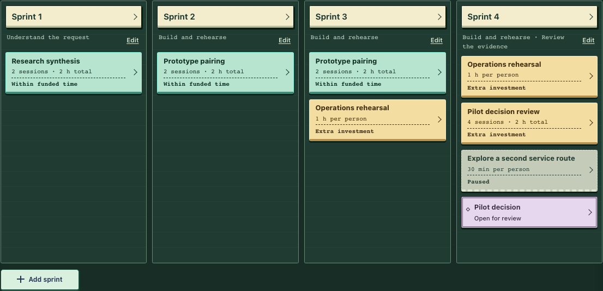
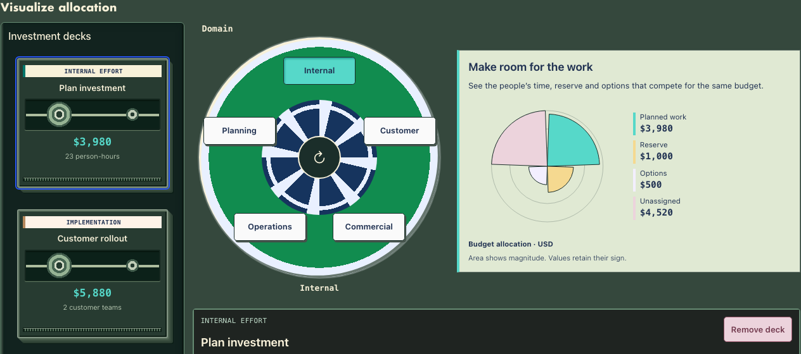

# Native Investment Studio

See how staffing and working sessions shape a project's cost. In the **Project
Resourcing & Spend Studio**, you can schedule work, assign people and review
responsibilities, and compare the resulting investment. The Studio runs inside
the [About page](../../context-canvas-project-surface/context-canvas/index.html#native-studio-coordination)
with a bundled example built for exploration.

## Run the Studio locally

From the repository root, start a static server with Python 3.

```sh
python3 -m http.server 8000 --bind 127.0.0.1
```

[Open the Studio in your browser](http://127.0.0.1:8000/context-canvas-project-surface/context-canvas/index.html#native-studio-coordination).
The example needs only the checkout, a static server and a browser. If you
already serve the repository root, use the same About path on that server.

## Try a change you can undo

Coordination opens on **All plans**, with four sprint columns. Session cards
show duration and funding status. Use them to inspect the work behind the total.



1. In **Sprint 3**, select the yellow **Operations rehearsal** card.
2. In the session editor, set **Minutes** to **15** and choose **Apply changes**.
   The session goes from 1 hour to 1 hour and 15 minutes per person. Watch the
   accepted investment rise from **$3,980.00** to **$4,030.00** in the Studio's
   top panel.
3. Choose **Undo** in the top panel to restore the original duration and total.
   Open **Investment** to see how planned work, reserve and options fit the
   example budget.



The accepted plan, unfinished edits, comparison baseline and Undo history live
in the open page. Reloading starts a fresh example. To carry an accepted plan to
another visit, apply the changes you want to keep, then choose **Investment →
Keep a plan → Download current plan**. The file contains the accepted plan.

## Choose your next step

| I want to… | Start here |
| --- | --- |
| Try the other chapters or recover an edit | [Explore the Studio](guide/README.md) |
| Trace an edit through the code and choose a test | [Develop and verify](development/README.md) |
| Look up plan data, investment calculations or editing contracts | [Implementation reference](implementation-reference.md) |
| Understand how the interaction design evolved | [Experience journal](experience-journal.md) and [Studio Rack visual contracts](../../visual-fidelity-contracts/studio-rack/README.md) |
| Find current work or report a problem | [Studio milestone](https://github.com/driftframestudios/human-ai-systems-exemplars/milestone/23) and [repository issues](https://github.com/driftframestudios/human-ai-systems-exemplars/issues) |

## How the code fits together

[About](../../context-canvas-project-surface/context-canvas/index.html) supplies
the markup and loads the browser [controller](controller.mjs). The controller
connects chapter controls to the accepted [plan state](state.mjs) and the
[editing coordinator](editing.mjs), which keeps unfinished inputs available
until you apply or cancel them. The Studio's JavaScript modules sit together
in this directory. The [Context Canvas README](../../context-canvas-project-surface/context-canvas/README.md)
describes the host page and its delivery.
