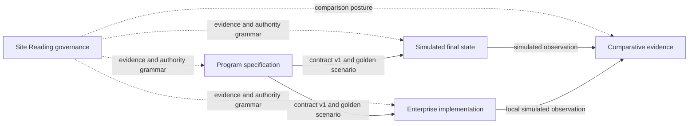

# LIMS/ELN Functional Nucleus

Laboratory teams need to know which specimen is in hand, what happened to it,
which result belongs to it, and who can rely on that result. A laboratory
information management system connects specimens, operations, and chain of
custody. An electronic laboratory notebook records experimental work and its
interpretation so teams can review and reproduce it.

This directory lets a reader follow one synthetic specimen through both kinds
of responsibility. It then brings five independently governed repositories
into one integrated encounter: shared contracts, a simulated selected future,
a working implementation, an independent comparison engine, and the governance
rules that connect their evidence and authority.

| Arriving with | Begin here | What becomes available |
| --- | --- | --- |
| A specimen-workflow or laboratory-operations question | [One useful vertical slice](#one-useful-vertical-slice) | One Golden Specimen journey across shared contracts, simulation, implementation, comparison, and governance |
| A software or architecture question | [System shape](#system-shape) | Repository roles, release coordinates, runnable entry points, and source authority |
| A need to run the integrated example | [Start with the workbench](#start-with-the-workbench) | A disposable local environment and the Golden Specimen Workbench |

The standalone repositories remain the source histories for releases, issues,
and durable ownership. This directory is a provenance-recorded exact-head
snapshot inside `human-ai-systems-exemplars`: it is the place to encounter the whole
system, exercise a cross-repository slice, and shape an intentional change
before reconciling that change with the owning repositories.

[`constellation-manifest.json`](constellation-manifest.json) records each role
and source coordinate. [`copy-receipt.json`](copy-receipt.json) records the
captured file set, exclusions, and parity evidence. The integrated surface
version is in [`VERSION`](VERSION).

## System shape



| Directory | Role | Current component release | Practical entry point |
| --- | --- | --- | --- |
| [`site-reading-governance`](site-reading-governance) | Shared evidence, authority, decision, and comparison grammar | Governance schema `2.0.1` | `tools/validate_governance.py` |
| [`lims-eln-program-specification`](lims-eln-program-specification) | Requirements, acceptance semantics, operation catalog, shared Python contracts, and the golden-specimen scenario | `0.3.1` | `src/lims_eln_contracts` |
| [`lims-eln-simulated-final-state`](lims-eln-simulated-final-state) | Executable selected-future behavior with explicit assumptions and simulated evidence | `0.3.1` | `lims_eln_sim.cli` |
| [`lims-eln-enterprise-implementation`](lims-eln-enterprise-implementation) | Domain services, adapters, persistence shapes, and the Golden Specimen Workbench | `0.3.1` | `lims-eln-workbench` |
| [`lims-eln-comparative-evidence`](lims-eln-comparative-evidence) | Independent admission, normalization, comparison, and adjudication | `0.3.1` | `comparative_evidence.cli` |

The governance schema and the constellation release carry different meanings.
Schema `2.0.1` versions the shared governance grammar. Nucleus `0.3.1` aligns
the four program repositories on Control Plane Profile `0.3.0` while each
repository retains its own release authority.

### Read captured member documentation as snapshot evidence

The five linked member READMEs describe the exact source revisions recorded in
the manifest and copy receipt. They are useful for reproducing this integrated
encounter; the corresponding standalone repository README and live GitHub work
remain the collaboration truth after the capture date. Scan aids belong in
this parent orientation unless a later snapshot regeneration explicitly
updates captured bytes.

For infrastructure questions, the captured Enterprise
[`infra/README.md`](lims-eln-enterprise-implementation/infra/README.md) explains
the local Compose production-shape and the Terraform evidence baseline. Use
Compose for the repository's synthetic local proof; use the Terraform route to
inspect architecture and recovery posture. The standalone Enterprise source
owns current prerequisites, checks, and adoption decisions.

### Follow one query into a runnable public example

The Registry's [PostgreSQL pending-outbox query · 0.1.0](https://kindlight.io/snippets/postgresql-pending-outbox-query/0.1.0/)
offers a smaller encounter with tenant-scoped counts, relational constraints,
and a matching partial index. Its package carries readable SQL, synthetic
fixtures, an independent count oracle, an owned PostgreSQL 17 runner, deliberate
predicate failures, and normalized plans. Start with its query meaning, then
use its documented proof when that mechanism answers the receiving question.

This separately versioned adaptation names its Enterprise source and license.
The nucleus members above retain their captured revisions; the example follows
its own accepted source and evidence. Equal query results support comparison
of the observed database work. Application authorization, full-response cost,
deployment workload, and recovery acceptance stay with the receiving system.
This repository's [relational execution review](../.agents/skills/relational-execution-review/README.md)
provides the corresponding source-review route, and the
[scientific skill ladder](../.agents/skills/README.md#continue-into-a-scientific-or-database-example)
routes figure-specific questions to optional public packages.

## One useful vertical slice

`SCN-GOLDEN-SPECIMEN-001` is the smallest complete thread through the nucleus:

1. The program package loads a strict, versioned specimen scenario and
   operation catalog.
2. The simulator executes the shared journey and emits an
   `ObservationEnvelope` classified as simulated evidence.
3. The implementation workbench carries the specimen through lifecycle,
   custody, instrument, vendor, and tenant boundaries and emits the same
   envelope contract and scenario identity when the contract package is
   available. Its process-local result is `simulated` / `verified`; an observed
   environment remains a separate evidence path.
4. The comparator admits each operational v1.2 envelope through a shared v1
   compatibility projection and preserves the distinction between simulated
   and observed evidence.
5. Governance keeps assurance stage, evidence mode, accountable authority, and
   production effect visible throughout the encounter.

This slice is deliberately small. It demonstrates domain behavior, evidence
lineage, recovery instructions, and cross-repository contract use while keeping
the nucleus focused as an integrated design and validation encounter. Synthetic
local evidence supports engineering decisions. Configured-environment qualification and
accountable Scientific, Quality, Regulatory, Security, and Operations decisions
retain their own receipt paths. Production authorization remains with those
accountable acceptance paths.

The simulator and workbench emit shared contract-v1 observations. The comparator
retains its operational v1.2 envelope and validates every admitted envelope
through the shared v1 compatibility projection. Its observed-admission path
accepts caller-supplied evidence; the checked-in comparison counterpart is a
planned synthetic contract shape. Role-specific inner `result` projections stay
named so each projection retains its explicit domain meaning. A focused next
slice can version one shared comparison projection after its cross-role domain
meaning is agreed.

## Start with the workbench

Python 3.12 or newer provides the common local runtime. Create one disposable
environment at this directory and install the shared contract plus the
implementation:

```sh
python3 -m venv .venv
. .venv/bin/activate
python -m pip install -e ./lims-eln-program-specification
python -m pip install -e './lims-eln-enterprise-implementation[test]'
lims-eln-workbench
```

Open `http://127.0.0.1:8000/workbench`. The dashboard starts with synthetic
identifiers and exposes lifecycle events, custody, raw-byte provenance,
normalized scientific results, digests, and vendor reconciliation in one
tenant-scoped read model. The implementation guide describes the bounded local
evidence posture and recovery path:
[`docs/golden-specimen-workbench.md`](lims-eln-enterprise-implementation/docs/golden-specimen-workbench.md).

Run each repository's focused proof from its own directory:

```sh
(cd site-reading-governance && python3 tools/validate_governance.py && python3 tools/check_language.py && python3 tools/scan_secret_shapes.py && python3 -m unittest discover -s tests -v)
(cd lims-eln-program-specification && python3 scripts/validate_program.py && python3 scripts/check_language.py && python3 scripts/scan_secret_shapes.py && PYTHONPATH=src python3 scripts/generate_contract_schemas.py --check && PYTHONPATH=src python3 -m unittest discover -s tests -v)
(cd lims-eln-simulated-final-state && PYTHONPATH=src python3 tools/validate_repository.py && PYTHONPATH=src python3 -m unittest discover -s tests -v && PYTHONPATH=src python3 tools/check_contract_conformance.py --contract-source ../lims-eln-program-specification/src)
(cd lims-eln-enterprise-implementation && python3 scripts/validate_repository.py)
python3 -m pip install -e './lims-eln-comparative-evidence[validation]'
(cd lims-eln-comparative-evidence && PYTHONPATH=src python3 tools/validate_repository.py && PYTHONPATH=src python3 -m unittest discover -s tests -v && PYTHONPATH=src python3 tools/check_contract_conformance.py --contract-source ../lims-eln-program-specification/src)
```

The enterprise validator runs 197 local tests. Seventeen live PostgreSQL, RLS,
and upgrade receipts activate when configured DSNs, a synthetic HMAC key, and
`psql` are available; static SQL, Flyway, tenancy, and workbench proofs remain
part of every local run.

The component READMEs remain the precise guides for their CLIs, contracts,
fixtures, and evidence boundaries.

## Snapshot and authority posture

This encounter captures the exact committed HEAD from each of the five sibling
source repositories after integration with its `develop` foundation. Every
source status was empty at capture. The manifest and copy receipt name each
branch, base branch, and commit, so a future collaborator can reproduce the
source state before applying the declared generated-output exclusions.

The copy keeps source-bearing material, including licenses, notices,
contribution guidance, governance records, release role documents, fixtures,
and dormant `.github` references. Nested Git databases, local environments,
package/build products, bytecode, test caches, and editor metadata stay outside
the encounter. Nested `.github` directories remain source-repository context;
workflows rooted at `human-ai-systems-exemplars/.github/workflows` form this
repository's runnable set. The enclosing repository carries two manual-gated
LIMS/ELN workflow definitions, including a bounded functional-nucleus proof.
Dependabot scheduling rests in `.github/dependabot.manual.yml`, a reviewed
activation template for npm, GitHub Actions, and the selected Python packages.
The resting repository setting keeps Actions disabled at a `$0` spend posture,
and local proof is the standing path.

Across the five source repositories, the active **Control Plane Protected
Delivery** rulesets retain deletion and non-fast-forward protection, one
approval, CODEOWNER review, stale-review dismissal, last-push approval,
review-thread resolution, unattributed-change approval, and the reviewed merge
methods. Their hosted required-check set is empty. The manifest records the
approved settings change; administrative-setting verification remains a
separate repository-settings receipt.

Changes made here should name the owning role and a bounded reconciliation
route. This keeps the integrated encounter useful for cross-repository design
while the five standalone repositories continue to carry source history,
release promotion, and issue ownership. See [`CONTRIBUTING.md`](CONTRIBUTING.md)
for the compact working agreement.

## Data boundary

Examples use invented `SYN-` identities and synthetic laboratory values.
Protected patient, customer, credential, and production telemetry values stay
in approved operational systems; repository evidence carries governed
references or redacted replacements. This boundary preserves a useful local
encounter and keeps the evidence scope legible.
