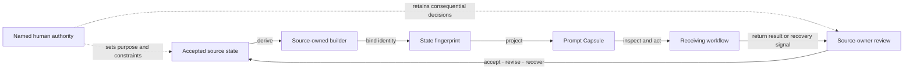

# Prompt Capsules

Prompt Capsules package accepted artifact state into readable, versioned
Markdown. A person or tool-supported workflow can inspect that state, return a
bounded result, and recover the authoritative source without treating the
projection as the source itself.

## At a glance

| Question | Answer |
| --- | --- |
| Use when | A receiver needs enough artifact state, context, and instruction to complete one bounded collaboration step. |
| Produces | Plain and skill-assisted Markdown views derived from the same accepted state. |
| Authority | The source artifact owns meaning and state; the capsule identifies the represented state and its owner. |
| Current contract | [`prompt-capsule/0.1.0`](0.1.0/prompt-capsule-contract.md) |
| Recovery | The capsule names the source route, state identity, evidence boundary, and return expected from the receiver. |

The public [Narrative
Capsules](https://kindlight.systems/narrative-architecture-orientation-index/narrative-capsules)
reading provides related narrative-architecture context. This directory owns
the repository's Prompt Capsule exchange contract and its source inventory.

## Start here

| Reader job | Open | What becomes available |
| --- | --- | --- |
| Understand or implement the contract | [Prompt Capsule 0.1.0](0.1.0/prompt-capsule-contract.md) | Required fields, view agreement, authority, and recovery behavior |
| Inspect a checked example | [Strategy Canvas capsule](0.1.0/examples/strategy-canvas.md) | A generated projection from canonical default state |
| Find the current owner of a capsule | [Classified inventory](prompt-capsule-inventory.v0.1.0.md) | Canonical sources, maintained projections, historical versions, and independently governed families |
| Choose a fitting check | [Repository test map](../tests/README.md) | Focused source, projection, and exchange checks |

## Exchange model

The same sequence in text:

1. A source owner accepts an artifact state.
2. The source-owned builder derives plain and skill-assisted Markdown.
3. Both views carry the same represented-state fingerprint.
4. A receiver inspects the capsule and completes the named return.
5. The source owner accepts, revises, or recovers the result.

The diagram expresses sequence and authority rather than quantity, rank, or
maturity. The ordered text remains the semantic companion.

## What every capsule carries

- source identity and a route back to its owner;
- represented-state identity or fingerprint;
- the evidence boundary for claims in the projection;
- the bounded return requested from the receiver;
- a recovery route for stale, incompatible, or incomplete state; and
- plain and skill-assisted views that agree on source state.

## Current adoption

| Source family | Current sources | Population owner |
| --- | ---: | --- |
| Core Architecture | 21 | [Core Architecture pack manifest](../core-architectures-chimeric-prototype-current-pack-v0.1/core-architectures-chimeric-prototype-manifest-v0.1.json) |
| Narrative Architecture | 4 | [Narrative collection manifest](../context-canvas-project-surface/context-canvas/prototypes/narrative-architectures/manifest.json) |
| Standalone instruments | 4 | [Classified inventory](prompt-capsule-inventory.v0.1.0.md#current-source-artifacts--29) |
| **Total** | **29** | [Prompt Capsule inventory](prompt-capsule-inventory.v0.1.0.md) |

The Core Architecture Family Index v0.1.6 joins twenty current Core
instruments. Across the collection, all 29 source artifacts implement `prompt-capsule/0.1.0`.
The inventory owns exact membership, versions, projection relations, and
historical standing. This README keeps the family-level orientation compact so
one manifest or source-version change has one named owner.

The four standalone sources remain directly discoverable:

| Source | Collaboration job |
| --- | --- |
| Open Lesson Field | Carry an accepted lesson state into a reviewed handoff. |
| Cross-Functional Investment Model Studio | Compare an accepted five-domain investment state. |
| Initiative Costing Calculator | Carry accepted analysis and explicitly captured staffing references. |
| Visualization Fidelity Atlas | Carry a selected visual form, recommendation, and machine-readable companions. |

## Family-specific contents

Each source projects the state its receiver needs while retaining its native
contract. Examples include:

- Strategy Canvas carries its decision object, dimensions, comparative
  readings, evidence bases, and human-held handoff scope.
- Context Tree carries roles, context questions, statuses, and handoff routes.
- Specification-by-Example carries rules and Given / When / Then outcomes.
- Threadkeeping Ledger carries chronology, decision state, and re-entry.
- Initiative Costing Calculator carries accepted analysis and explicitly
  captured staffing references while people retain economic authority.

The [classified inventory](prompt-capsule-inventory.v0.1.0.md) supplies the
complete source-by-source account and distinguishes current sources from
projections, generated receivers, and historical inputs.

## Authority and verification

The source artifact and its accepted state remain semantic authorities. Its
builder owns deterministic projection. A represented-state fingerprint lets a
receiver compare both views and recognize drift. Focused source-family tests
establish view agreement and recovery behavior for the revision they exercise;
they leave content acceptance and consequential decisions with their named
owners.

Another artifact joins this contract when its owner can derive both views from
one accepted state, preserve source authority and recovery behavior, expose a
readable default, and protect active-view byte agreement with a focused test.

## Concrete example

Given an accepted Strategy Canvas state, its builder creates plain and
skill-assisted capsules with one fingerprint. A receiving workflow can inspect
the same scenario and contribution state in either view, return the requested
analysis, and point back to the source when the fingerprint has changed. The
capsule makes that exchange recoverable while the Strategy Canvas remains the
state owner.

## Continue

- Use the [inventory](prompt-capsule-inventory.v0.1.0.md) to resolve ownership.
- Use the [0.1.0 contract](0.1.0/prompt-capsule-contract.md) to implement a compatible projection.
- Use the [test map](../tests/README.md) to choose a focused behavior check.
- Return to the [repository root](../README.md) for the wider source, evidence, and publication model.
