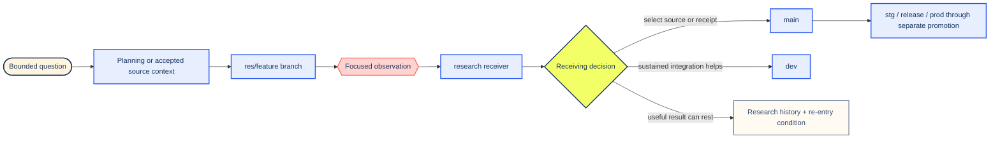

# Research branch activity

The `research` branch gives a team room to try a possible future, measure what
happens, and keep the result available before selecting durable repository
source. In everyday terms: ask one useful question, pin the starting point,
run the smallest observation that can change a decision, and leave the next
person a result they can reproduce or responsibly set aside.

Research can end in a selected implementation, a revised protocol, a useful
negative result, or a clearly bounded unknown. Each of those outcomes can move
the work forward when the record says what was attempted, what the evidence
establishes, and who receives the next decision.

## At a glance

| Need | Fitting route |
| --- | --- |
| Compare options before source work begins | Write or update a file in [`planning/`](../planning/README.md). |
| Answer one bounded future-state or evidence question | Branch `res/<feature-slug>` from the accepted `research` coordinate and return it through a pull request to `research`. |
| Coordinate several related research features | Use `epic/<semantic-name>` and retain named human review plus an explicit merge cue at the epic boundary. |
| Change ordinary current repository behavior | Target `main` through the normal collaboration route. |
| Integrate a selected direction over time | Hand the reviewed result to `dev` when sustained integration adds value. |
| Preserve settled rationale or a re-entry point | Return the durable account to [`threadkeeping/`](../threadkeeping/README.md). |
| Confirm branch and promotion policy | Read [`BRANCHING.md`](../BRANCHING.md#research-flow), which remains the authority for branch topology. |

The [current `research` tree on
GitHub](https://github.com/driftframestudios/human-ai-systems-exemplars/tree/research/research)
shows activity that has reached the long-lived research receiver. GitHub
Issues and pull requests carry current work state, acceptance, and review.
This README explains how to form and return that work; it stays one derivation
edge from those live owners.

## How the branch fits the repository

`main` and `research` answer different questions. `main` carries the broadest
accepted collaboration source. `research` carries bounded experiments,
future-state implementations, comparative evidence, and implementation
rehearsals whose durable receiving form is still being selected.



*Research branch decision route.* The diagram shows a working path; maturity
and ranking stay outside its meaning. A pull request can revise the experiment, send a selected
change to accepted source, or preserve a useful resting result. Production
promotion follows its own reviewed branch contract.

## Authority stays close to the thing it governs

| Owner | What it establishes |
| --- | --- |
| Checked-out runnable source | Behavior at the exact branch revision being exercised |
| [`BRANCHING.md`](../BRANCHING.md) | Long-lived branch jobs, research namespaces, synchronization, review, promotion, and Actions posture |
| Study README and protocol | Research question, accepted inputs, method, evidence boundary, stopping event, and recovery route |
| Tests, fixtures, and observation code | Behavior and measurements within their named cases and operating limits |
| Normalized result or research receipt | The outcome observed at one pinned source, protocol, input, and environment boundary |
| GitHub Issue | Current intended outcome, scope, acceptance, and coordination state |
| Pull request | Exact proposed branch change, review conversation, evidence return, and receiving decision |
| `main` | Durable source or concise research receipt selected through review |
| Named human reviewer | Epic-boundary acceptance and consequential publication, deployment, or promotion decisions |

A research README routes readers among these owners. GitHub retains mutable
issue state, Git retains branch coordinates, and the named delivery record
retains deployment standing. A dated coordinate belongs in a study protocol
or receipt when it is part of reproducibility.

## Choose the smallest branch that answers the question

### Use `res/<feature-slug>` for one bounded question

A research feature has one primary question, one intended receiver, and a
locally reversible change. Examples include comparing two verification
policies, rehearsing a schema migration, or testing whether one interface
instrument changes a named decision.

The branch is ready to begin when the working record names:

1. the decision the research should inform;
2. the people, workflow, or repository component affected;
3. the accepted source coordinate and any pinned input coordinates;
4. the claim classes in view: verified fact, supported inference,
   practitioner observation, proposal, or open hypothesis;
5. the smallest observation that can change the decision;
6. the publication, privacy, credential, and locator boundary;
7. the runtime, dependency, time, matrix, storage, and Actions budget;
8. the checkpoint, interruption, and recovery behavior;
9. the event that ends the experiment or returns it to rest; and
10. the next receiver for each materially different outcome.

### Use `epic/<semantic-name>` for a joined future

An epic fits a target future that spans several features or materially changes
repository architecture, schema posture, workflow, service, or promotion. Each
feature can still enter through a bounded `res/*` pull request. A named human
reviews the assembled delta and supplies the explicit cue before an epic merges
into `research` or another long-lived branch.

### Use `main` for ordinary current collaboration

Branching into research adds value when isolation, future-state integration,
comparative evidence, or a distinct recovery boundary matters. A complete and
reviewable improvement to current behavior can target `main` directly.

## Start or re-enter from current truth

Begin with read-only branch evidence:

```sh
git fetch --prune origin
git rev-parse origin/main origin/research
git rev-list --left-right --count origin/main...origin/research
git log --left-right --cherry-pick --oneline origin/main...origin/research
git diff --stat origin/main...origin/research
```

These commands establish branch coordinates, unique history, and the scale of
the current tree difference. They leave semantic compatibility, experimental
readiness, and acceptance for their fitting source and reviewers.

At the start of an epic, before a consequential comparison, and before a
promotion receipt, bring current `main` into `research` through additive,
reviewable history as specified in [`BRANCHING.md`](../BRANCHING.md#synchronization-and-re-entry).
After the accepted research coordinate is current, an isolated feature begins
from that exact point:

```sh
git switch --create res/example-question origin/research
```

Replace `example-question` with a short semantic label. Record the exact base
coordinate in the Issue, pull request, or study README when later reproduction
depends on it.

## Give each study a readable and reproducible shape

A small study can use only a README, one source file, and one focused test. A
larger study earns additional files when each one carries a distinct job:

```text
research/<study-slug>/
  README.md                 # question, standing, source, result, next receiver
  PROTOCOL.md               # method, observations, limits, stop and recovery
  protocol.json             # executable parameters when code consumes them
  model.mjs                 # research implementation or calculation
  model.test.mjs            # focused behavioral and numerical boundaries
  fixtures/                 # synthetic, open, or authorized bounded inputs
  epochs/                   # dated append-only observations or checkpoints
  .local/                   # ignored raw logs, screenshots, runtime copies
```

The smallest fitting structure wins. A prose-only inquiry can remain a
well-bounded document. A repeatable measurement should carry machine-readable
parameters, focused assertions, and a normalized result that another
collaborator can inspect without replaying every raw log.

### Study README contract

Lead with the practical question and current standing. Then provide:

1. **Question and receiver** — the decision this study informs and who receives it.
2. **Why it matters** — the affected work and material consequence in everyday language.
3. **Source coordinates** — exact application, research, fixture, schema, and protocol versions.
4. **Accepted inputs** — their origin, license or authorization, selection rule, and digest where useful.
5. **Method** — actions, comparison, units, states, thresholds, and bounded assumptions.
6. **Evidence boundary** — what each observation establishes and which adjacent claims remain open.
7. **Reproduction** — runtime, dependency lock, setup, commands, random seed, time budget, and expected output shape.
8. **Interruption and recovery** — checkpoints, locks, partial results, resume rule, and atomic publication point.
9. **Results** — observed values, missingness, uncertainty, anomalies, and claim class.
10. **Return** — selected change, resting record, follow-up question, Issue, pull request, and re-entry condition.

## Evidence should change the next decision

A research observation earns its place when it can alter implementation,
verification, adoption, rest, or a later experiment. Measurement volume alone
does not establish usefulness.

| Evidence form | What it can establish | Boundary to keep visible |
| --- | --- | --- |
| Source reading | Current declared behavior, relationships, and owned constraints | Runtime behavior needs its fitting execution or observation. |
| Unit or contract check | The named cases satisfy their assertions at the tested revision | Uncalled paths and unasserted behavior remain unspecified. |
| Browser observation | The named interaction, engine, viewport, and media condition behave as observed | Other engines, states, assistive routes, and network conditions need their own evidence when consequential. |
| Simulation | Behavior of the declared model under its inputs and assumptions | A simulated result remains separate from production incidence and causal effect. |
| Comparative run | Difference between named treatments under one protocol | Generalization depends on population, regime, measurement, and transfer conditions. |
| Practitioner observation | A situated pattern worth testing or preserving | Experience supplies a hypothesis or local warrant rather than universal prevalence. |
| Accepted pull request | A reviewer selected the exact source change for its target branch | Merge acceptance and wider operational effectiveness remain distinct claims. |

Lead with what a signal establishes. Place its transfer or coverage boundary
beside it. Missing measurements remain visibly missing, and an indeterminate
result remains a valid research outcome. This preserves the difference between
uncertainty and failure while keeping both actionable.

### Keep units and comparison logic explicit

- Name the observation unit before counting outcomes.
- Separate elapsed machine time, eligible exposure, browser launches, cases,
  human effort, and financial cost.
- Record a prediction before observing the comparison when prediction quality
  is part of the question.
- Preserve dependence within a family, session, participant, or repeated run.
- Distinguish a probability of an event from an expected event count.
- Label priors, thresholds, and scenario parameters as assumptions until data
  supports estimation.
- Keep causal language with designs that can support a causal claim.
- Report changed protocols as new epochs rather than silently joining regimes.

## Reproduction creates a usable handoff

Another collaborator should be able to reconstruct the relevant state or
understand exactly why a replay remains bounded. A reproducible record names:

- full source and protocol commit object IDs;
- dependency lock and tool versions;
- platform details that can change the result;
- fixture identity, digest, selection, and authorization;
- deterministic ordering, seed, clock, and locale controls where relevant;
- setup cost separately from measured work;
- focused invocation and expected normalized output;
- checkpoints, completed units, remaining budget, and resume rules;
- failure categories with specific recovery actions; and
- files that carry raw, normalized, and accepted evidence.

Repository-managed dependencies and existing runners lead. New packages,
harnesses, and workflows earn adoption by answering a material question or
reducing demonstrated repetition. An independent implementation can provide a
useful numerical or contract cross-check when it exercises the complete result
shape rather than mirroring the same code path.

### Protect interruption and partial progress

A long-running study writes durable checkpoints after complete units of work.
An interrupted unit records its partial standing, and the next invocation
resumes only work whose source, protocol, and runtime identity still match.
Atomic promotion moves a completed normalized result into its accepted path.
Locks identify possible active writers; a collaborator confirms process state
before clearing a stale lock.

## Route artifacts according to their audience and risk

| Artifact | Preferred resting place |
| --- | --- |
| Question, options, or proposed method | `planning/` until the research work has an active receiving branch |
| Study orientation, protocol, code, synthetic fixtures, and focused tests | `research/<study-slug>/` on the research branch |
| Raw logs, screenshots, local runtime copies, copied dependencies, and temporary credentials | Ignored local study storage or an existing access-controlled owner |
| Normalized result needed for review | Research pull request or the study directory when publication review accepts it |
| Current coordination and acceptance | GitHub Issue and pull request |
| Selected implementation or concise semantic receipt | Pull request to `main`, or `dev` when sustained integration adds value |
| Settled rationale and exact re-entry condition | `threadkeeping/` |
| Stable visitor publication | An explicitly reviewed publication route after source selection |

Tracked public records use repository-relative paths, stable public locators,
and normalized evidence. Credentials stay in their named environment; private
routes, query-bearing URLs, raw headers, local filesystem coordinates, and
unreviewed participant or benchmark material stay with their authorized owner.
A public receipt carries the smallest decision-changing result, coverage
boundary, and next receiver.

Research previews begin as pull-request artifacts, ignored local output, or a
purpose-bound ephemeral route. A stable host or custom domain follows a named
service and publication decision.

## Keep automation proportionate to the evidence question

Local execution is the immediate research loop. A proposed hosted workflow
names the research question, trigger, path scope, expected duration, matrix
width, permissions, secret boundary, cache, retention, concurrency,
cancellation, and event that returns the workflow to rest.

Manual dispatch or a narrowly scoped pull-request trigger provides the leanest
first receiver. Observed value can justify a schedule, larger matrix, longer
retention, additional active receiver, or recurring spend. Repository and
environment configuration remain with the owners named in
[`BRANCHING.md`](../BRANCHING.md#actions-receivers-and-evidence-budgets) and
[`.github/ENVIRONMENTS.md`](../.github/ENVIRONMENTS.md).

## Return the result through a deliberate receiving decision

| Research outcome | Next action |
| --- | --- |
| Evidence supports a durable source change | Select the smallest coherent implementation and concise receipt for review into `main`. |
| The direction needs sustained integration | Hand the reviewed feature to `dev` with source coordinates and its open boundaries. |
| The work forms a deployment candidate | Enter `stg` through the separate promotion procedure after source acceptance. |
| The protocol exposed a fixable method problem | Revise the protocol, start a new epoch, and preserve the earlier observation. |
| The hypothesis was unsupported under the tested conditions | Preserve the normalized negative result and the conditions it covers. |
| The result remains indeterminate | Keep the study at rest with the exact evidence or authority change that would reopen it. |
| Several features form one target future | Assemble the epic receipt; a named human supplies the explicit outward merge cue. |

Promotion selects the evidence and implementation that a receiver can use;
research history keeps the complete experiment available. The receiving pull
request names:

- the exact research coordinate;
- selected files, claims, and behavior;
- fitting checks and what they establish;
- unresolved or intentionally resting material;
- retained history, license, and attribution;
- recovery or rollback route; and
- the next human, branch, service, or publication decision.

A research commit can remain as reproducibility evidence after `main` receives
the durable result. That separation lets the accepted source stay concise
while the experiment remains inspectable.

## Concrete example — protective verification windows

The research branch currently preserves a
[protective-verification study](https://github.com/driftframestudios/human-ai-systems-exemplars/tree/research/research/table-verification-threshold)
that asks whether a team can choose focused or full test campaigns with better
timing while preserving protective discovery and coherent handoff.

The study uses several strong research practices:

- It models **Discovery → Repair → Verification → Handoff** as explicit states
  and records which evidence reopens an earlier state.
- It separates check yield, later invalidation, elapsed exposure, browser
  launches, case attempts, and human effort.
- It stores probability models, numerical limits, scenario assumptions, and
  an independent Python reference as distinct evidence sources.
- It records repair epochs as append-only events and keeps the current summary
  separate from historical entries.
- Its [paired replay
  protocol](https://github.com/driftframestudios/human-ai-systems-exemplars/tree/research/research/table-verification-threshold/paired-replay-02)
  pins application, protocol, runtime, fixture, approval, interruption, and
  publication boundaries before browser measurement.
- The current feasibility receipt retains an important result: the readiness
  and accounting procedure can be reviewed, while effectiveness and
  calibration remain indeterminate until the named observations exist.

From a checkout of the research branch, the focused model and record checks
include:

```sh
node --test research/table-verification-threshold/model.test.mjs
node --test research/table-verification-threshold/epochs/table-repair-01.test.mjs
uv run --isolated --no-project --python 3.12 --managed-python -- \
  python -m unittest discover \
  -s research/table-verification-threshold \
  -p test_reference_check.py -v
```

These commands establish their declared model, record-integrity, and reference
comparison cases. Browser-policy effectiveness remains with the separately
approved measurement protocol. The example shows the intended branch posture:
implementation can become rigorous before the evidence warrants a wider claim.

## Copy-ready study opening

Use this compact shape when a new research directory forms:

```md
# <Study name>

## Question and receiver

This study helps <role or system> decide <specific decision>.

## Why it matters

<Affected everyday work, people, and material consequence.>

## Source and accepted inputs

- Application source: `<full commit>`
- Research base: `<full commit>`
- Protocol: `<path and version>`
- Inputs: `<origin, selection, authorization, digest>`

## Method and stopping event

<Actions, comparison, observation unit, budget, and completion condition.>

## Evidence boundary

<What the result establishes, transfer conditions, and open claims.>

## Reproduce and recover

<Environment, setup, commands, checkpoint, interruption, and resume rule.>

## Result and next receiver

<Observed result, claim class, Issue or pull request, and re-entry condition.>
```

## Practice continuations

- [Population Cartography &
  Research](https://kindlight.systems/core-architectures-orientation-index/population-cartography-research)
  begins with the people who carry the work and its consequences.
- [Repository
  Re-entry](https://kindlight.systems/field-watch/field-watch-signal-room/repository-re-entry)
  supports an evidence-based return to branch state and decision authority.
- [Proportionate Response Under Uneven Goal
  Fidelity](https://kindlight.systems/field-watch/field-watch-signal-room/proportionate-response-under-uneven-goal-fidelity-restore-the-intended-effect)
  helps a team restore the intended effect through the smallest fitting repair.
- [Bounded Packages & Return
  Receipts](https://kindlight.systems/field-watch/field-watch-signal-room/bounded-packages-return-receipts-recursive-orchestration-for-long-horizon-humanai-work)
  provides a wider model for finite support packets and handbacks.

## Completion

Research activity is ready to hand back when another collaborator can identify
the question, affected work, exact source and inputs, method, observation,
claim class, evidence boundary, reproducibility route, interruption behavior,
publication boundary, receiving decision, and re-entry condition in one
coherent traversal. [`BRANCHING.md`](../BRANCHING.md) continues to own branch
and promotion policy; the study README owns local method and standing; the
Issue and pull request own current coordination and acceptance.
