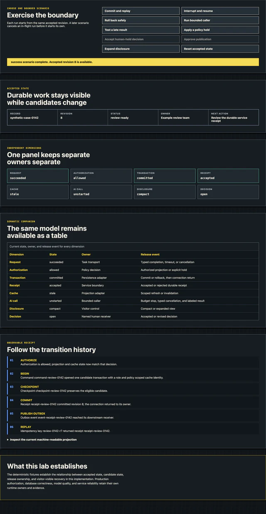
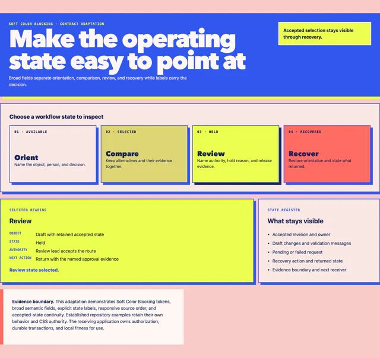
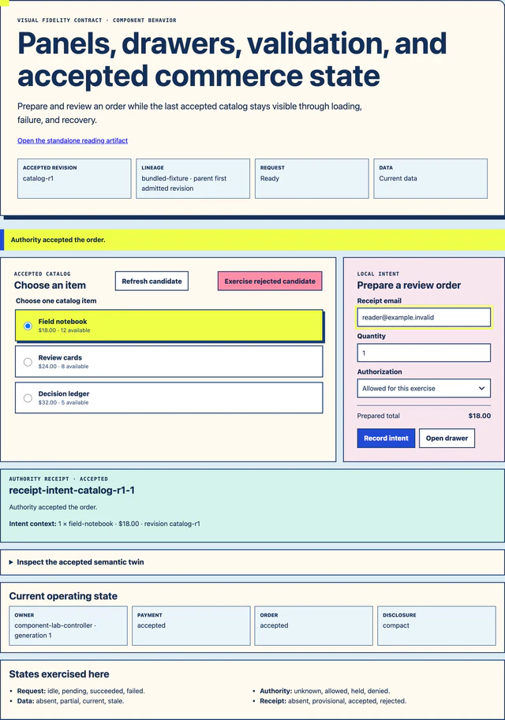
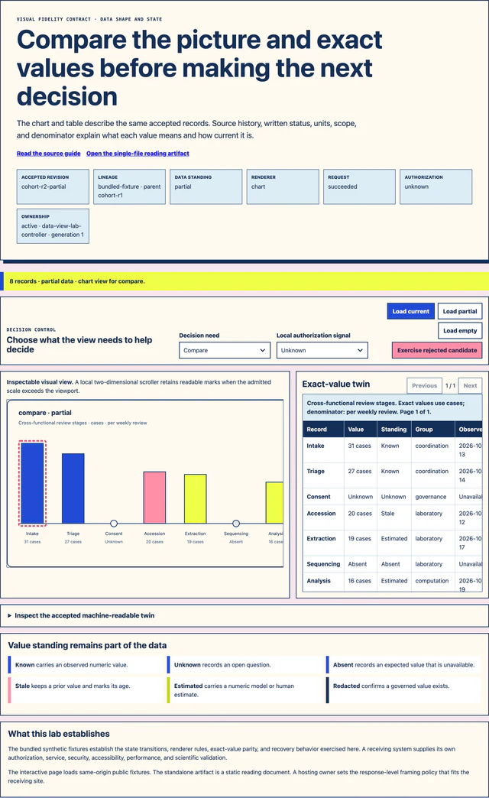

# Visual Fidelity Pattern Library

This library shows representative states from contracts and labs maintained in
this repository. Each figure has a responsive image family, a written
description, a semantic companion, and a route back to the behavior and tests
that establish it.

Begin with the family that resembles the work in front of you. The image offers
a quick orientation. The adjacent text, source, contract, and tests carry the
implementation meaning.

## Choose a family

| Family | Useful when | Runnable or inspectable source |
| --- | --- | --- |
| Industrial Ink | A technical instrument needs dense state, precise labels, and bounded action | [Service Boundary Lab](../labs/service-boundary-lab/README.md) |
| Soft Color Blocking | A workflow or diagram needs approachable regions and direct state labels | [Soft Color Blocking specimen](../contracts/soft-color-blocking/specimen.html) |
| Component and recovery | A panel, drawer, or commerce flow needs accepted state, local intent, authority, and recovery | [Component Lab](../labs/component-lab/README.md) |
| Data view and evidence | A data view needs a visible decision purpose, value standing, lineage, and an exact-value twin | [Data-View Lab](../labs/data-view-lab/README.md) |

## See the four visual families

Each preview below is a repository-generated documentation image. Its linked
source and semantic companion carry the state, behavior, and reading meaning
alongside the visual treatment.

### Industrial Ink



The dark technical instrument keeps status, authority, and recovery actions in
one inspectable field. [Open the full-size image](./images/industrial-ink/industrial-ink-service-boundary-1600.webp)
or [inspect the owning lab](../labs/service-boundary-lab/README.md).

### Soft Color Blocking



The color regions separate related work while labels preserve each region's
purpose and current state. [Open the full-size image](./images/soft-color-blocking/soft-color-blocking-workflow-1600.webp)
or [inspect the contract specimen](../contracts/soft-color-blocking/specimen.html).

### Component and recovery



The accepted receipt, editable intent, and recovery path remain distinct while
sharing one visible state. [Open the full-size image](./images/component-and-recovery/component-accepted-recovery-1600.webp)
or [inspect the owning lab](../labs/component-lab/README.md).

### Data view and evidence



The graphical view and exact-value representation derive from the same accepted
dataset. [Open the full-size image](./images/data-view-and-evidence/data-view-value-standing-1600.webp)
or [inspect the owning lab](../labs/data-view-lab/README.md).

Open the [rendered gallery](./index.html) to compare all four families. The
machine-readable [`catalog.v1.json`](./catalog.v1.json) joins each preview to
its source, contract, responsive derivatives, checksum, semantic companion,
rights standing, and focused checks.

## Read a pattern record

Every record answers six questions:

1. **What work does this pattern support?** The everyday-language description
   names the task and changed ability.
2. **What is visible?** Alt text describes the materially meaningful state in
   the image.
3. **Why is this image here?** The figure caption explains its role in the
   library.
4. **Which source carries the behavior?** A local route points to the runnable or
   inspectable implementation.
5. **Which contract owns the visual grammar?** A stable contract ID, version,
   and public continuation keep meaning and publication distinct.
6. **What has been checked?** Tests and the semantic companion describe the
   evidence carried by the example.

Headings, descriptions, captions, links, and companion tables preserve the
essential relationships while an image loads and in text-only readings.

## Build and verify

The source definitions live in
[`source/example-definitions.v1.json`](./source/example-definitions.v1.json).
The capture tool opens each local source in Chromium, exercises the declared
state, captures the owned region, removes embedded metadata through the WebP
encoding step, and writes 640, 1280, and 1600 pixel-wide derivatives.

```sh
npm run build:visual-fidelity-pattern-library
npm run check:visual-fidelity-pattern-library
```

The build captures each declared state into a candidate family. It checks the
pinned 1600-pixel image receipts, catalog, semantic companions, public-locator
boundary, and secret-shaped material before the candidate replaces the accepted
family. A successful replacement retires image and companion paths owned by the
prior catalog when the new catalog has superseded them. A rejected candidate or
interrupted replacement restores every prior generated file at the same bytes.
Each example's source and browser checks also resolve through
the corresponding owner in the main Visual Fidelity catalog. The check compares
the accepted catalog, images, semantic companions, and deterministic digest of
every declared source file; a changed source set therefore requires a reviewed
rebuild. It also verifies intrinsic dimensions, derivative ordering, SHA-256
checksums, metadata standing, rights, and responsive markup. Browser checks
cover 320 CSS pixels, 200% text resize, forced colors, keyboard disclosure, and
an unavailable-image reading.

Run the build in a working tree. It promotes validated files with the catalog
last and restores prior bytes when a write fails. A packaged release or
deployment activation owns the reader-atomic boundary for a live service.

## Source and publication boundary

The repository license applies to the maintained HTML, CSS, JavaScript,
fixtures, tests, and generated screenshots in this library. `AUTHORS`,
`LICENSE`, `CITATION.cff`, and the visible artifact notices carry the exact
attribution and licensing record. The screenshots are documentation
derivatives of synthetic local examples. Their catalog records name the
declared source set and generation method.

The [Visual Fidelity Contracts](https://kindlight.systems/visual-fidelity-contracts)
collection is the public entrance. Public routes in this library identify
continuations that already exist there. Repository source remains the authority
for the runnable examples added in this tranche.

## Re-entry

A changed source state, contract version, browser baseline, crop, alt text,
caption, rights standing, or checksum reopens the fitting example record. Run
the build after a source definition or captured state changes so the catalog,
companions, gallery, and images advance together. Run the check on every change
to the library or its referenced contracts.
